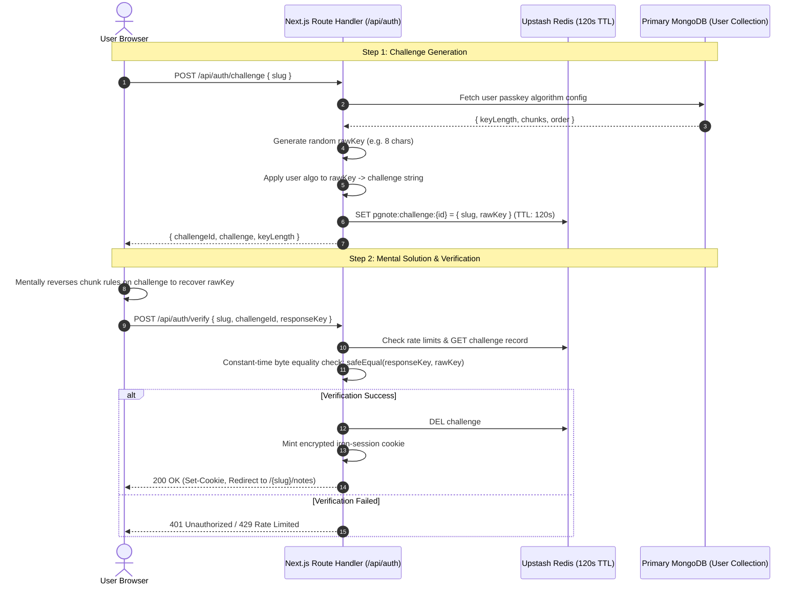
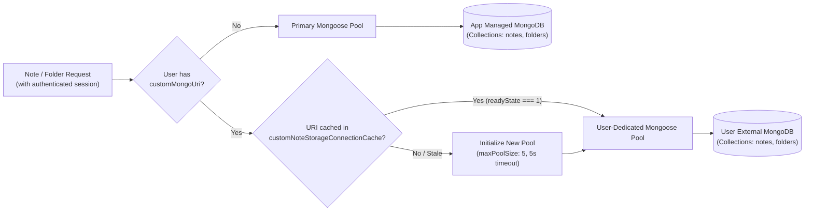
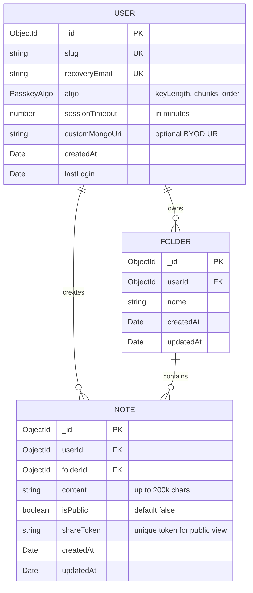

# pgnote

> **Privacy-first, terminal-aesthetic personal note workspace** built with **Next.js 16 (React 19)**, **MongoDB**, and **Upstash Redis**.
> Features zero-stored-password mental passkey challenge-response authentication, BYOD (Bring Your Own Database) note storage isolation, and a 3-panel resizable workspace.

---

## Architecture Overview (UML & Flow)

GitHub natively renders Mermaid diagrams. Below are the comprehensive architecture diagrams detailing system components, authentication sequence, and database topology.

### 1. System Component Architecture

```mermaid
flowchart TD
    subgraph ClientTier["Client Layer"]
        Browser["User Browser<br/>(React 19 / Tailwind CSS v4 / Radix UI)"]
        Cookies["Client Storage<br/>(Sealed iron-session Cookie)"]
    end

    subgraph AppServer["Next.js 16 Application Server"]
        subgraph UILayer["App Router (Pages & Views)"]
            Home["Landing / Entry<br/>(/)"]
            AuthView["Challenge Screen<br/>(/{slug})"]
            NotesView["3-Panel Workspace<br/>(/{slug}/notes)"]
            PublicView["Public Note Viewer<br/>(/public/{shareId})"]
        end

        subgraph APILayer["API Route Handlers"]
            AuthRoute["Auth Endpoints<br/>(/api/auth/challenge, /verify, /logout)"]
            RecoveryRoute["Recovery Endpoint<br/>(/api/auth/recovery)"]
            NotesRoute["Notes & Folders Endpoints<br/>(/api/notes, /api/folders, /share)"]
        end

        subgraph CoreServices["Server Services & Middleware"]
            SessionHandler["Session Handler<br/>(lib/session.ts)"]
            PasskeyEngine["Algo Engine<br/>(lib/passkey.ts & algo-description.ts)"]
            Mailer["Mailer Service<br/>(lib/mailer.ts / Nodemailer)"]
            StorageRouter["Dynamic Storage Engine<br/>(lib/note-storage.ts)"]
        end
    end

    subgraph FastTier["Upstash Redis (In-Memory / Edge)"]
        ChallengeCache["Challenge Store<br/>(Key: pgnote:challenge:{id} | 120s TTL)"]
        RateLimits["Sliding Window Rate Limiter<br/>(Login: 5/15m | Recovery: 3/10m)"]
        RecoveryCooldown["Recovery Cooldown Store<br/>(5m TTL)"]
    end

    subgraph PersistenceTier["Database Layer"]
        PrimaryDB[("Primary MongoDB<br/>(Users, Slugs, Default Folders & Notes)")]
        UserDB[("User External MongoDB (BYOD)<br/>(Isolated Custom Notes & Folders)")]
    end

    %% Client to UI Routing
    Browser <--> Cookies
    Browser -->|HTTP GET Navigation| UILayer

    %% Client Fetch to APIs
    Browser -->|POST Challenge & Verify| AuthRoute
    Browser -->|POST Recovery Request| RecoveryRoute
    Browser -->|CRUD Notes & Folders| NotesRoute
    PublicView --> StorageRouter

    %% API to Internal Services
    AuthRoute --> SessionHandler
    AuthRoute --> PasskeyEngine
    AuthRoute --> RateLimits
    AuthRoute --> ChallengeCache
    AuthRoute --> PrimaryDB
    SessionHandler <-->|Read / Write Sealed Cookie| Cookies

    RecoveryRoute --> RateLimits
    RecoveryRoute --> RecoveryCooldown
    RecoveryRoute --> PrimaryDB
    RecoveryRoute --> Mailer

    NotesRoute --> StorageRouter
    StorageRouter -->|Default User Storage| PrimaryDB
    StorageRouter -->|Custom MongoDB URI (BYOD)| UserDB
```

---

### 2. Zero-Password Challenge-Response Auth Sequence



---

### 3. Bring-Your-Own-Database (BYOD) Note Storage Model



---

### 4. Data Entity Relationship (ERD)



---

## Core Features

- **Zero-Password Mental Passkey:** No plaintext or hashed password stored. Ephemeral OTP challenge generated and solved mentally via personalized chunk transformations.
- **BYOD (Bring Your Own Database):** Users can link their personal MongoDB connection string; note data never persists in the core application database.
- **Timing-Attack Protection:** Constant-time equality validation (`safeEqual`) prevents timing attacks during challenge checks.
- **Upstash Redis Rate Limiting:** Sliding-window rate limiter (5 attempts / 15 mins for login; 3 attempts / 10 mins for recovery).
- **3-Panel Resizable Dashboard:**
  - Folders panel (collapsible, cascade delete with alert modal)
  - Full-height bash-styled editor (markdown preview, live word/char counters, Ctrl+S shortcuts)
  - Notes list panel (search, auto-title, pin, copy, share, delete)
- **Debounced Autosave:** 5-second inactivity autosave with inflight race-condition protection.
- **Public Note Sharing:** Generate public read-only URLs at `/public/{slug}.{token}`.
- **Encrypted Stateless Sessions:** Sealed cookie sessions powered by `iron-session` with automatic timeout detection and warnings.

---

## Tech Stack

- **Framework:** Next.js 16 (App Router), React 19, TypeScript
- **Styling:** Tailwind CSS v4, Radix UI Primitives, Lucide Icons, Sonner
- **Database:** MongoDB & Mongoose 9
- **Cache / Rate Limiting:** Upstash Redis & `@upstash/ratelimit`
- **Session:** `iron-session`
- **Validation:** Zod
- **Email:** Nodemailer

---

## Getting Started

### 1. Clone & Install Dependencies

```bash
git clone https://github.com/Pranav1632/pgnote.git
cd pgnote
pnpm install
```

### 2. Environment Variables

Create a `.env.local` file based on `.env.example`:

```env
MONGODB_URI=mongodb+srv://...
UPSTASH_REDIS_REST_URL=https://...
UPSTASH_REDIS_REST_TOKEN=...
SESSION_PASSWORD=at-least-32-characters-long-secret
SMTP_HOST=smtp.gmail.com
SMTP_PORT=587
SMTP_USER=...
SMTP_PASS=...
```

### 3. Run Development Server

```bash
pnpm dev
```

Open [http://localhost:3000](http://localhost:3000) to view the application.

---

## License

MIT © [Pranav](https://github.com/Pranav1632)
